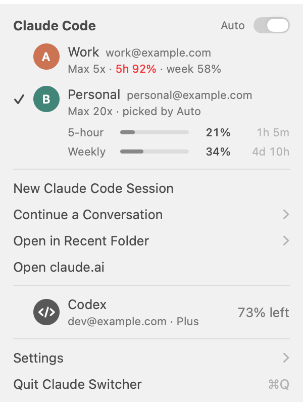
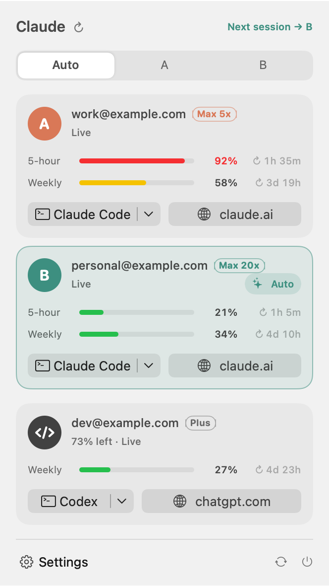
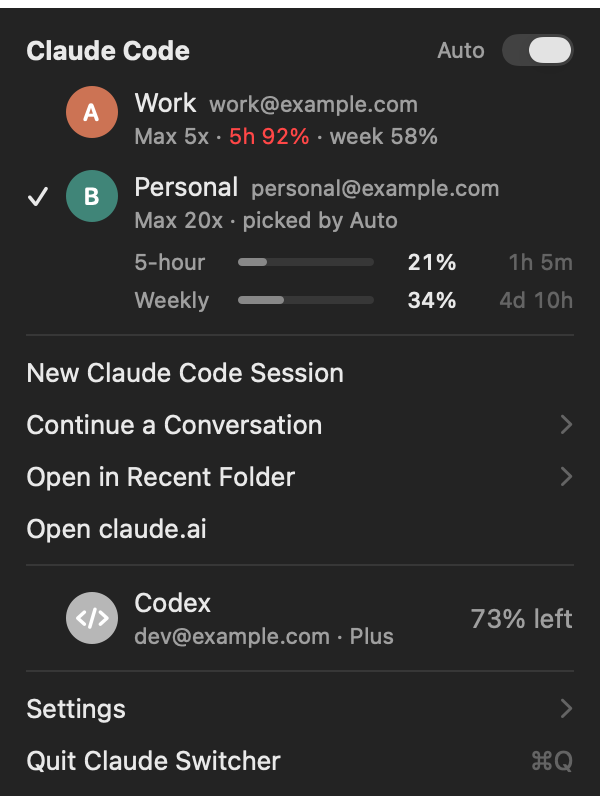

<h1 align="center">Claude Switcher</h1>

<p align="center">
  <b>Two Claude Code accounts. One click to switch. Live usage in your menu bar.</b>
</p>

<p align="center">
  <a href="https://github.com/hamdalaa/claude-switcher/releases/latest"></a>
  <a href="https://github.com/hamdalaa/claude-switcher/releases"></a>
  <a href="https://github.com/hamdalaa/claude-switcher/actions/workflows/ci.yml"></a>
  
  <a href="LICENSE"></a>
</p>

<p align="center">
  
</p>

Hit your Claude limit in the middle of a task? If you have a second Claude subscription (say, work
and personal), Claude Switcher puts both in your menu bar. You see how much each has left, switch
with one click, and **continue the same conversation on the other account**. Your settings, skills,
agents and memory come along. Up to four accounts.

> **Unofficial.** A community project, not made by or affiliated with Anthropic or OpenAI.

## Install

```sh
brew install --cask hamdalaa/tap/claude-switcher
```

Or [download the app](https://github.com/hamdalaa/claude-switcher/releases/latest), unzip it, and move
it to Applications. It's free and open source, but not notarized, so the first time macOS will
block it: open **System Settings → Privacy & Security → Open Anyway**.

Then click the account icon in your menu bar, choose **Sign In to Account B…**, and log in with your
second account.

**Requirements:** macOS 15 or later (Apple silicon or Intel) and [Claude Code](https://docs.claude.com/en/docs/claude-code/overview)
signed in. Optional: Chrome, Brave, Edge, Chromium or Vivaldi for per-account claude.ai windows, and
the [Codex CLI](https://github.com/openai/codex) for Codex usage.

### Let your AI set it up

Paste this into Claude Code (or any AI coding agent with terminal access):

```text
Install Claude Switcher (https://github.com/hamdalaa/claude-switcher) on this Mac and set it up
for my two Claude accounts. Follow its README and llms.txt. Specifically:
1. Check macOS 15+ (`sw_vers`), that Claude Code works (`claude --version`), and that account A is
   signed in (`claude auth status`). If something is missing, stop and tell me.
2. Install with `brew install --cask hamdalaa/tap/claude-switcher`; if Homebrew isn't available,
   download the latest release zip, verify its .sha256, and move the app to /Applications.
3. Open it: `open -a "Claude Switcher"`.
4. Sign in account B: run
   `"/Applications/Claude Switcher.app/Contents/Resources/ccx" login b`
   and tell me to finish the browser login with my SECOND account (not account A).
5. Ask me whether plain `claude` should follow the switch. Only if I say yes, run
   `"/Applications/Claude Switcher.app/Contents/MacOS/ClaudeSwitcher" --install-hook`.
6. Show me the result of `ccx status` (or the bundled ccx above).
Rules: never read, print or copy tokens or Keychain items; never edit my shell files yourself.
```

## What you get

- **One-click switching.** Click an account and new sessions start on it. Or turn on **Auto**, which
  picks whichever has more room left. Sessions that are already running keep their account.
- **Continue on another account.** When one account hits its limit, switch and choose **Continue a
  Conversation** after exiting the original session. Shared state is checked before the saved
  conversation resumes. No extra prompt, summary, or model request is generated by the handoff.
- **Live usage.** 5-hour and weekly limits for both accounts straight from Anthropic, with time to
  reset. Numbers turn orange at 70% and red at 90%, and you get an alert when an account fills up or
  frees up again.
- **One setup, separate logins.** Accounts B–D share account A's settings, `CLAUDE.md`, skills,
  agents, commands, hooks, plugins, MCP servers, project and subagent memory, plans, task lists and
  history. Logins and live process registries stay separate. Name
  them ("Work", "Personal") and add up to four.
- **claude.ai per account.** Each account gets its own browser window, so both stay signed in
  without touching your everyday browser profile.
- **Plain `claude` follows the switch** (optional shell hook for zsh, bash and fish), plus the
  `ccx` command for scripts.
- **Codex usage** too, if you use the Codex CLI.
- Your terminal of choice: Terminal, iTerm2, Ghostty, kitty or WezTerm.
- **Stays up to date.** It checks GitHub for new versions once a day and updates in one click
  (through Homebrew if you installed it that way).

<p align="center">
  
  
</p>

## Using it

| You want to… | Do this |
|---|---|
| Switch accounts | Click the account. ✓ marks where new sessions start |
| Let it choose | Turn on **Auto** (picks the account with more room left) |
| Start Claude Code | **New Claude Code Session**, or **Open in Recent Folder** |
| Keep going after a limit | Exit the original session, switch accounts, then **Continue a Conversation** |
| Add another account | **Add Account…** (up to four) |
| Name or remove an account | Right-click its row → **Rename…** / **Remove Account…** |
| Use claude.ai | **Open claude.ai**: a separate window per account |
| Act on the other account | Right-click its row |
| Change a picture | Right-click a row → **Change Picture…**, or drop an image on it |
| Settings | Terminal, `claude` hook, `ccx` command, open at login, alerts |

### The `ccx` command

```text
ccx                  start on the switched-to account
ccx a|b|c|d [...]    start on a specific account (extra args go to claude)
ccx run [...]        like ccx, but passes ALL args to claude
ccx use <acct>|auto  set the switch
ccx which            print which account the next session uses
ccx login <acct>     sign an account in (signing in C or D adds it)
ccx logout <acct>    sign an account out
ccx remove <acct>    sign out and remove account B, C or D
ccx status           accounts, usage, current switch
ccx sync             re-link shared config into the other accounts
ccx resume <acct> <session-id> [-- <options>]  check shared state and resume the exact session
```

### Continue without extra summarization tokens

1. Exit the original Claude Code session so its last turn is saved. Stop any background session
   through Claude Code first.
2. Select the other account and choose **Continue a Conversation**, or run
   `ccx resume b <session-id>` from any directory.
3. The handoff checks shared files, validates the saved transcript, checks for a known live process,
   and opens the same session in its original folder. Send your next message when ready.

The existing transcript is the durable record of your conversation. Project files, saved plans,
task lists and memory remain on disk; the switcher does not ask a model to summarize, rewrite or
verify them. Repeated switches add **zero model calls and zero injected prompt tokens**.
Claude Code's normal resume/next-turn usage still applies. Reusing the same transcript does not
guarantee a cache hit across accounts or make a long conversation free to process.

The checked path requires the standard local `projects/<project>/<session-id>.jsonl` layout and
session persistence. It rejects inherited API-key/provider authentication overrides that would
bypass the selected subscription. It refuses missing, ambiguous or incomplete transcripts,
unavailable folders, and conflicting shared paths. Since transcripts do not reliably identify the originating account,
it checks **all configured accounts**, including when switching back to A. Existing files and
incorrect links are left intact. Back up and reconcile the paths reported by `ccx sync` before
retrying; do not delete an account's private task lists or memory just to silence the warning.
See [handoff details and validation](docs/handoff.md).

Claude Code restores the state recorded in its transcript, including its model where supported.
Settings files are shared and re-read. If the original session used launch-only options, supply
them explicitly, for example:

```sh
ccx resume b <session-id> -- --model <model> --mcp-config /absolute/path/to/mcp.json
```

Supported handoff options: `--model`, `--agent`, `--effort`, `--permission-mode`, `--mcp-config`,
`--settings`, `--plugin-dir`, `--add-dir`, `--fallback-model`, `--system-prompt`,
`--append-system-prompt` (each followed by one value; repeat options for multiple paths), and
`--strict-mcp-config`. Options are forwarded, never saved. Prompts, session overrides, background
launches and forks are rejected. `ccx run` and `ccx b --resume …` remain raw passthroughs for advanced
use and do **not** perform these handoff checks.

**Limits:** this preserves supported saved state, not an in-flight model response or a running
tool/subagent. Claude Code's own compaction still applies; switching cannot recover details already
summarized out of its active context. Account-specific tools, permissions or model availability may
differ. Live-process detection uses Claude Code's local session registry and is best-effort, not a
lock against concurrent launches. Always exit the original session first. Ordinary claude.ai chats
and Projects are not transferred.

## How it works

- **Separate logins, shared saved state.** Claude Code reads its config from
  `CLAUDE_CONFIG_DIR`. Account B runs with `CLAUDE_CONFIG_DIR=~/.claude-b` (C and D likewise), where `ccx` keeps
  symlinks to A's `settings.json`, `CLAUDE.md`, `skills/`, `agents/`, `commands/`, `hooks/`,
  `plugins/`, `projects/`, `tasks/`, `plans/`, `agent-memory/`, `workflows/` and `history.jsonl`.
  Shared state directories are created before launch, so a first memory/task write uses the common
  directory. A few account-independent keys from `~/.claude.json`
  (such as `mcpServers`) are copied over. The login is never copied.
- **Each login stays in its own Keychain item.** Claude Code stores A as `Claude Code-credentials`
  and B as `Claude Code-credentials-<hash of ~/.claude-b>`. Signing in, refreshing and signing out
  are all done by Claude Code itself.
- **The switch** is one file, `~/.claude-accounts/default` (`a`, `b`, or absent for Auto). `ccx`,
  the shell hook and the app all read it.
- **Live usage** comes from the same endpoint Claude Code's `/usage` uses.

## Privacy & security

- **No telemetry, no servers of ours.** Network requests: `GET https://api.anthropic.com/api/oauth/usage`
  for each signed-in account, and once a day `GET https://api.github.com/repos/hamdalaa/claude-switcher/releases/latest`
  to check for updates (Settings → Check for Updates Daily turns it off).
- **Tokens are read, never written.** The app reads each account's access token from the Keychain
  (via `/usr/bin/security`) only to ask for usage. It never stores, logs, refreshes or modifies a
  token. Expired tokens are renewed by Claude Code itself (`claude auth status`).
- **Your files:** it writes under `~/.claude-accounts/` and `~/.claude-b/`, short-lived launch
  scripts in `$TMPDIR`, and only if you turn them on, `~/.local/bin/ccx` and one marked block in
  your shell config (backed up first). A `~/.local/bin/ccx` it didn't install is never overwritten.
- The usage endpoint isn't a documented public API. If it changes, usage may stop showing until an
  update. Switching keeps working regardless.

Full list in [SECURITY.md](SECURITY.md).

## FAQ

**Is this allowed?** It automates what you can already do by hand with `CLAUDE_CONFIG_DIR` and two
subscriptions you own. You're responsible for following Anthropic's
[terms](https://www.anthropic.com/legal/consumer-terms) and [Usage Policy](https://www.anthropic.com/legal/aup).

**Does it work with API keys, Bedrock or Vertex?** Switching does. Live usage needs a claude.ai
login (Pro / Max).

**Why not just log out and back in?** That throws away your session state, and you can't run both
accounts side by side. Here both stay signed in, and sessions on A and B can run at the same time.

**Can I keep a conversation going after hitting the limit?** Yes. Exit the original session, switch
to the other account, then choose **Continue a Conversation** and pick it. The checked handoff resumes
the saved conversation through `claude --resume`, using Claude Code's normal compaction/resume rules.

**Plain `claude` still uses A.** Turn on **Plain `claude` follows the switch** in Settings, then open
a new terminal tab. Check with `ccx which`.

**Usage says "Sign-in expired".** Start one session on that account. Claude Code renews its login
and usage comes back.

**iTerm2 doesn't open.** Allow Claude Switcher under System Settings → Privacy & Security → Automation.

**How do I uninstall?** In Settings, turn off the `claude` hook and the `ccx` command. Then quit and
delete the app. Optionally remove `~/.claude-accounts/`. To drop account B entirely, run
`CLAUDE_CONFIG_DIR=~/.claude-b claude auth logout` and delete `~/.claude-b`.

## Optional: status line

`statusline.sh` (in the app at `Contents/Resources/`) shows the current account and both accounts'
usage in Claude Code's status line. Add to `~/.claude/settings.json`:

```json
"statusLine": { "type": "command", "command": "/Applications/Claude Switcher.app/Contents/Resources/statusline.sh" }
```

## Build from source

Only the Xcode Command Line Tools are needed (`xcode-select --install`).

```sh
git clone https://github.com/hamdalaa/claude-switcher.git && cd claude-switcher
scripts/test.sh            # Swift tests
tests/ccx_test.sh          # end-to-end tests for ccx
scripts/bundle.sh --install
```

Setup without the UI: `ClaudeSwitcher --install-hook | --remove-hook | --install-cli | --remove-cli`.
Screenshots with sample data: `ClaudeSwitcher --demo [--demo-mode a|b] --snapshot out.png [--dark]`.

## Contributing

Issues and pull requests are welcome; see [CONTRIBUTING.md](CONTRIBUTING.md). AI coding agents should
read [AGENTS.md](AGENTS.md) first.

If Claude Switcher saves you from a limit, a ⭐ helps other people find it.

## License

[MIT](LICENSE)
